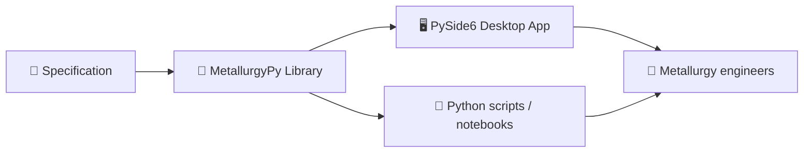
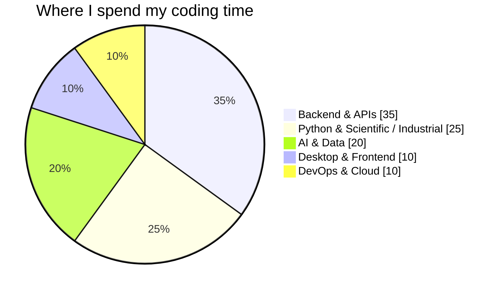

###  Python • .NET • AI • Data Engineering • Industrial Software

  
  
  

📍 Democratic Republic of Congo 🇨🇩 &nbsp;•&nbsp; 💼 Open for Freelance • Remote • Full-Time

---

# 👨‍💻 About Me

I'm a passionate **Backend & Full-Stack Developer** focused on designing modern, scalable and secure software — from enterprise web apps to scientific and industrial tools.

| 🔨 I build | 🌱 Currently exploring |
|---|---|
| 🌍 Enterprise Web Applications | ASP.NET Core & Clean / Onion Architecture |
| 🔌 REST APIs | CQRS & Event-Driven Architecture |
| ☁️ Cloud-ready solutions | Docker, Kubernetes, Azure |
| 🧠 AI & Machine Learning projects | Artificial Intelligence |
| 📉 Data Analytics applications | Scientific computing in Python |
| ⚙️ Industrial & Metallurgy Software | Desktop apps with PySide6 |

---

# 💻 Tech Stack

**Languages**

**Backend**

**Frontend & Desktop**

**Database**

**DevOps & Cloud**

**Tools**

---

# 🚀 Featured Projects

## ⚗️ MetallurgyPy — Python Metallurgy Library + Desktop App

  
  
  
  

A complete **Python library for metallurgy** paired with a **PySide6 desktop application**, built from my own detailed specification (written in French). The library holds the scientific logic; the desktop app makes it usable by engineers without writing code.

> 🎯 **Goal:** a reusable, well-structured metallurgy toolkit that works both as an importable package and as a standalone desktop application.

## 📦 Other Projects

| Project | Description | Stack |
|---|---|---|
| 💼 **HR Management System** | Enterprise human-resources application | .NET, ASP.NET Core |
| 📡 **JM WIFI ZONE** | WiFi zone management solution | Web / Backend |
| 🧠 **AI Industrial Decision Support** | AI-assisted decision making for industry | Python, ML |
| 📉 **Data Analytics Projects** | Data exploration and dashboards | Python, SQL |
| 🌍 **Enterprise APIs** | Secure, scalable REST APIs | .NET, Python |

---

# 🎯 Focus Areas

---

# 📊 GitHub Statistics

  
  

# 📅 Contribution Streak

  

# 📈 Activity Graph

  

# 🏅 Trophies

  

---

# ✉️ Contact

  
  

### 🤝 Thanks for visiting my profile!

*"Building reliable software that solves real-world problems."*

